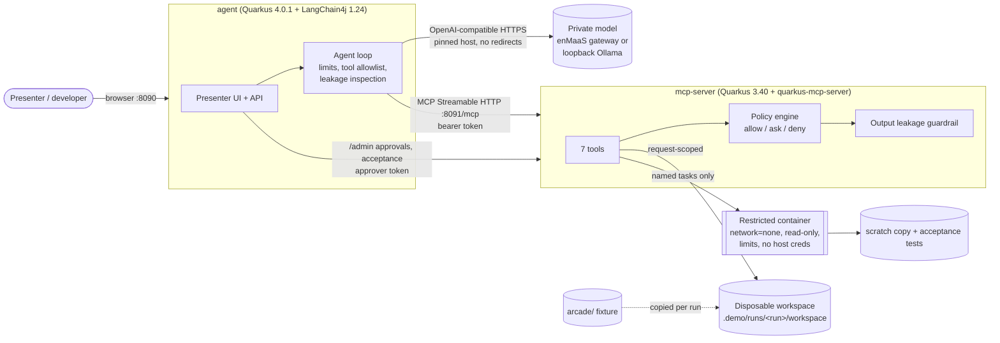

# Your Code Never Leaves: a private coding agent in Java

A small, runnable blueprint for a Claude Code-style coding agent built with **Quarkus**, **LangChain4j** and a
**Java MCP server**, using inference you control (a loopback model or an approved private gateway), with
guardrails enforced in code: secrets protection, data-leakage detection, unsafe-command blocking and
allow/ask/deny action control.

## Architecture



| Component | Directory | Role |
|-----------|-----------|------|
| Java coding agent | [`agent/`](agent) | Agent loop, conversation state, model client, MCP client, presenter UI. **Talks to the model; never touches files.** |
| Model configuration | [`agent/.../model`](agent/src/main/java/io/agentcon/blueprint/agent/model), [`profiles/`](profiles) | `enterprise`, `local` and `scripted` profiles; endpoint validation; guarded HTTP client. |
| Java MCP server | [`mcp-server/`](mcp-server) | Seven focused tools over MCP Streamable HTTP. **Touches the workspace; never talks to a model.** |
| Policy and output inspection | [`guardrails/`](guardrails) | Framework-free policy engine, path containment, leakage inspector, approval store. |
| Isolated target workspace | [`arcade/`](arcade) → `.demo/runs/<run>/workspace` | Fixture copied per run; the agent can only change it through approved patches. |
| Independent verification | [`acceptance/`](acceptance), `SandboxRunner` | Presenter-owned acceptance tests run in a restricted container. |
| Demo setup | [`scripts/`](scripts), [`docs/`](docs) | Doctor, dependency preparation, start/stop, rehearsal, probes, evidence, reset. |

The agent cannot edit its own policies, credentials, acceptance checks or runtime: they live in other processes
and directories that no tool can reach.

## Quick start

Prerequisites: Java 25, Podman (or Docker) for restricted verification, and either an enMaaS API key or a local
OpenAI-compatible model server. macOS: `podman machine start`.

```bash
scripts/prepare-deps.sh
```

```bash
scripts/doctor.sh enterprise
```

```bash
scripts/start.sh enterprise
```

Open <http://127.0.0.1:8090>. Other profiles:

```bash
scripts/start.sh local
```

```bash
scripts/start.sh scripted
```

`enterprise` reads [`profiles/enterprise.env`](profiles/enterprise.env) (enMaaS gateway, model id) and the key from
`$ENMAAS_KEY`. `local` reads [`profiles/local-ollama.env`](profiles/local-ollama.env) (loopback Ollama).
`scripted` is a deterministic, clearly labelled fallback that performs **no inference**: tool calls are
pre-recorded, while MCP, policy and sandbox stay real. See [docs/configuration.md](docs/configuration.md).

Rehearse and stop:

```bash
scripts/happy-path.sh
```

```bash
scripts/probes.sh
```

```bash
scripts/evidence.sh
```

```bash
scripts/stop.sh
```

## What the agent can do

1. **Inspect** the target repository: `list_files`, `search_text`, `read_file` (bounded, policy-checked, inspected).
2. **Explain** a narrow change in its answer.
3. **Produce a reviewable diff**: `propose_patch` (exact find/replace on one file, returns a unified diff and a proposal id).
4. **Request approval**: the proposal is `ASK` until the presenter approves *that exact diff* in the UI.
5. **Apply** the approved change: `apply_patch` re-checks authorization, approval, patch hash and file version, once.
6. **Verify**: `run_verification` with a named task (`unit-tests`, `acceptance-rps`, `acceptance-scramble`).
7. **Report** the actual result; `show_diff` returns the real workspace diff.

Limits per request (configurable): 10 model steps, 12 tool calls, 8,000 tool-output characters delivered to the
model, 240 s wall-clock. Conversation state lives only in the agent (bounded to 40 messages).

## Guardrails (enforced in code, not in the prompt)

| Guardrail | Where | What it does |
|-----------|-------|--------------|
| Secrets protection | `PolicyEngine`, `WorkspacePaths` | Protected paths (`config/**`, `.env`, keys, `.git/**`, `.mvn/**`…) are denied for read and write; traversal, absolute paths and symlinks are rejected. |
| Data-leakage detection | `LeakageInspector` in the MCP output guardrail **and** the agent loop | Synthetic canary, representative secret patterns and the `AGENT-RESTRICTED` marker are redacted or blocked before content reaches a model request, the trace or a log. |
| Unsafe-command blocking | `VerificationTasks`, `SandboxRunner` | No shell tool. Only named tasks with fixed argument lists, executed in a restricted container; fails closed if isolation is unavailable. |
| Policy-based action control | `PolicyEngine`, `ApprovalStore` | Reads ALLOW, propose ALLOW, apply ASK until approved (bound to workspace, path, patch hash and file hash; expires; single use), everything else DENY. |

Details and remaining limitations: [docs/threat-model.md](docs/threat-model.md).

## Demo

The 10–12 minute presenter path, with exact prompts and expected observations, is in
[docs/runbook.md](docs/runbook.md). Reset and troubleshooting: [docs/troubleshooting.md](docs/troubleshooting.md).

## Endpoints

| Process | Endpoint | Purpose |
|---------|----------|---------|
| agent `127.0.0.1:8090` | `/` | Presenter UI |
| | `GET /api/status`, `GET /api/presets`, `GET /api/session?after=n` | Profile, endpoint host, model, trace |
| | `POST /api/ask`, `GET /api/proposals`, `POST /api/proposals/{id}/approve\|reject` | Agent run and approvals |
| | `POST /api/verify/{task}`, `POST /api/probes/{name}`, `GET /api/evidence`, `POST /api/reset` | Checks, probes, evidence, fresh workspace |
| mcp-server `127.0.0.1:8091` | `/mcp` | MCP Streamable HTTP (agent bearer token) |
| | `/admin/*` | Approvals, audit, acceptance, reset (approver token; not an MCP tool) |
| arcade `localhost:8080` | `/`, `/rps`, `/scramble`, `/quiz` | Pristine fixture for the baseline (`scripts/arcade-baseline.sh`) |

## Tests

```bash
./mvnw verify
```

```bash
./mvnw -pl mcp-server test -Dsandbox.it=true
```

```bash
./mvnw verify -pl agent -am -Dreal-model.it=true -Dreal-model.profile=enterprise
```

| Suite | What it proves |
|-------|----------------|
| `guardrails` unit tests | Path traversal/symlink handling, policy decisions, leakage rules, approval binding, expiry and replay. |
| `mcp-server` `McpToolsTest` | Real MCP discovery and invocation over Streamable HTTP; protected files, escapes, canary redaction, approval integrity, command denial, audit redaction. |
| `mcp-server` sandbox tests | Container flags; timeout kills the container; no engine means fail closed with nothing run on the host. Opt-in `SandboxContainerTest` runs real containers: acceptance fails before and passes after an approved fix. |
| `agent` unit tests | Endpoint policy, redirect and destination pinning, loop limits, tool allowlist, untrusted wrapping, a **capturing model endpoint** proving sensitive values never reach model requests. Use a deterministic fake model, labelled as such. |
| `agent` `AgentEndToEndIT` | Packaged MCP server and agents as separate processes: approval flow, probes, captured model requests, sandboxed acceptance (skipped if no container engine), redacted logs and evidence. |
| `agent` `RealModelIT` (opt-in) | A configured real model drives real MCP tools and never sees the canary. |

## Versions

Quarkus 4.0.1 (agent, arcade), LangChain4j 1.24.0, langchain4j-mcp 1.24.0-beta34, Java 25. The MCP server stays on
Quarkus 3.40.1.2 with quarkus-mcp-server 2.0.4 because quarkus-mcp-server 2.1.0 (managed by the 4.0.1 platform)
still references the Jackson 2 `ObjectMapperCustomizer` that Quarkus 4 removed; move it to 4.x once a compatible
release ships. They are separate processes, so the mix is safe.

Guides: [Quarkus MCP server](https://docs.quarkiverse.io/quarkus-mcp-server/dev/),
[LangChain4j MCP](https://docs.langchain4j.dev/tutorials/mcp),
[LangChain4j OpenAI-compatible](https://docs.langchain4j.dev/integrations/language-models/open-ai),
[Quarkus REST](https://quarkus.io/guides/rest), [Quarkus config mappings](https://quarkus.io/guides/config-mappings),
[Quarkus testing](https://quarkus.io/guides/getting-started-testing).

The arcade's own documentation (games, seeded bugs, prompts for other assistants) is in
[arcade/README.md](arcade/README.md). `opencode.jsonc` configures OpenCode against the same enMaaS gateway.
