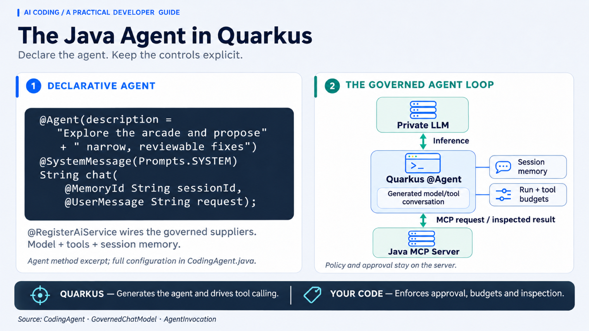
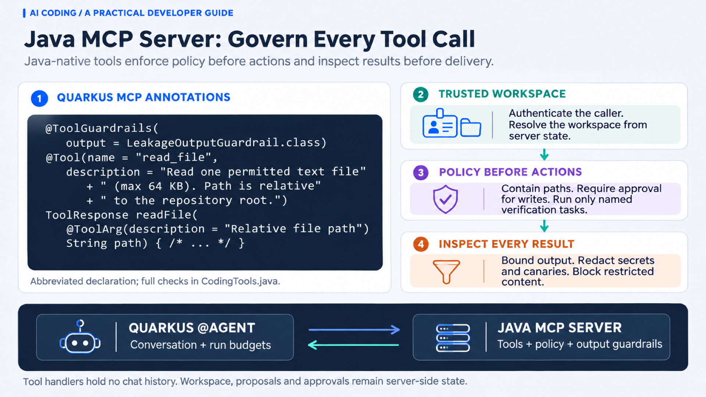

# Jfokus 2027: slides 9 and 10

Replacement images for positions **9 and 10 in the expanded deck**, aligned to the declarative agent implementation introduced in commit `4082fc1`. Both PNGs are 1920 × 1080 (16:9). They match the deck's light developer-guide style, navy typography, colored cards and dark takeaway bar.

## Slide 9 — The Java Agent in Quarkus

The code panel is an agent-method excerpt from [`CodingAgent.java`](../../agent/src/main/java/io/agentcon/blueprint/agent/core/CodingAgent.java). The complete `@RegisterAiService` attributes and supplier classes are intentionally outside the excerpt. The diagram includes [`GovernedChatModel`](../../agent/src/main/java/io/agentcon/blueprint/agent/core/GovernedChatModel.java) and [`AgentInvocation`](../../agent/src/main/java/io/agentcon/blueprint/agent/core/AgentInvocation.java); the annotation alone does not enforce the application's controls.

Speaker notes (about 75 seconds):

> This is the coding agent we will use in Act 2. The method declares its role, system prompt, developer request and session identity. Quarkus creates the injectable implementation, and LangChain4j drives the model/tool conversation. The full interface also uses RegisterAiService to wire our governed model, MCP tools and session memory. Those suppliers matter: our code still inspects results, enforces run budgets and routes inference through the approved private endpoint. The MCP server remains a separate process and owns the actual workspace actions and approval checks. We have changed the implementation, while keeping the same presenter flow. A normal tool-calling conversation does not require a LoopAgent workflow of multiple sub-agents.

## Slide 10 — Java MCP Server: Govern Every Tool Call

The panel abbreviates the declaration of `read_file` from [`CodingTools.java`](../../mcp-server/src/main/java/io/agentcon/blueprint/mcp/CodingTools.java). Metadata is shortened and the method body is omitted; this is a presentation excerpt, not a copy-and-run implementation. `@Tool` and `@ToolGuardrails` are the actual Quarkus MCP server annotations. The real method enforces path, read-policy, file-size and UTF-8 checks; [`LeakageOutputGuardrail`](../../mcp-server/src/main/java/io/agentcon/blueprint/mcp/LeakageOutputGuardrail.java) inspects the result before delivery.

Speaker notes (about 75 seconds):

> The agent can request an action, but the server decides whether it may happen. Tool exposes a focused Java method over MCP. ToolGuardrails routes the result through our leakage inspection before it leaves the server. The method body, omitted here, gets the workspace from trusted server state and applies path and read-policy checks. Other tools require approval before a write or restrict execution to named verification tasks. This separation is what we will test live: a model request cannot grant its own approval or reach arbitrary files. The handlers keep no chat history, but the server does have workspace, proposal and approval state. Stateless conversation handling does not mean the entire server has no state.

The agentic API is experimental. See [implementation notes](../declarative-agent.md) for the pinned runtime's standalone-agent advisory, JVM validation and real-model test limits. Image generation prompts are retained in [image-prompts.md](image-prompts.md).
