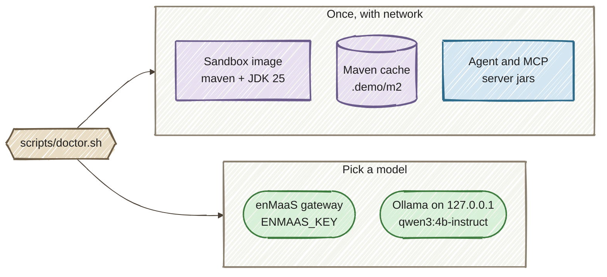

# 01 · Set up

## Goal

Prepare everything once: the container image and Maven dependencies for sandboxed verification, a model (enMaaS or
local), and a pre-flight check that tells you the demo is ready.

## What you prepare



## Steps

### 1. Prepare dependencies

```bash
scripts/prepare-deps.sh
```

This pulls the sandbox image, builds the jars, and fills `.demo/m2` from the **pristine** arcade with network access.
Later, every verification run uses that cache read-only and has no network at all. Acceptance failures printed here are
expected: the arcade still has its bugs.

### 2. Choose a model

**enMaaS (default).** Put your key in your shell profile, then open a new terminal:

```bash
export ENMAAS_KEY=...   # in ~/.zshrc; never commit it
```

The gateway, model and approved host are in [`profiles/enterprise.env`](../../profiles/enterprise.env). The
default model is `rits/deepseek-ai/DeepSeek-V4.1-Flash-1017`; `rits/zai-org/glm-5-3` also works.

**Local (offline).** Use a non-thinking instruct model:

```bash
ollama pull qwen3:4b-instruct
```

> **Warning:** the plain `qwen3:4b` tag is a thinking-only build. It spends 30 to 100 seconds per step on hidden
> reasoning, so use `qwen3:4b-instruct`.

### 3. Check that everything is ready

```bash
scripts/doctor.sh enterprise
```

```bash
scripts/doctor.sh local
```

## What you should see

```text
==> Restricted execution (sandbox)
  OK   podman available
  OK   network=none blocks egress inside the sandbox
  OK   prepared Maven cache: 108M
==> Model (enterprise)
  OK   API key found in $ENMAAS_KEY (68 chars, not shown)
  OK   endpoint host: api.enmaas.devshift.net
  OK   model 'rits/deepseek-ai/DeepSeek-V4.1-Flash-1017' is available
  OK   ready
```

List every model the gateway offers with `scripts/doctor.sh enterprise --models`.

## Key takeaways

- Dependency download (with network) is separate from verification (without network).
- The model endpoint, model id and approved host are explicit configuration; there is no public default.
- The key stays in your shell; it is never written to a file in the repository or shown in the UI.

Details: [configuration](../configuration.md).
