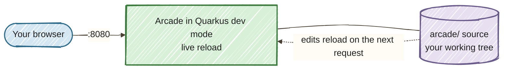

# 02 · Play the arcade

## Goal

Run the arcade with live reload and reproduce the three bugs in a browser, so the audience sees each one before it is
fixed.

## What runs



## Steps

### 1. Start the arcade in dev mode

Use a terminal you keep open during the demo:

```bash
cd arcade && ../mvnw quarkus:dev
```

Dev mode recompiles on the next request after a source change, so a page reload shows a fix immediately.

### 2. Reproduce each bug

| Game | Open | What you should see |
| --- | --- | --- |
| ✊ Rock Paper Scissors | <http://localhost:8080/rps?move=banana> | "banana vs PAPER — 💀 You Lost!" with HTTP 200. Invalid input is silently a loss. |
| 🔤 Word Scramble | <http://localhost:8080/scramble?word=serverless&guess=SERVERLESS> | "❌ Nope!": the right word in capitals is rejected. |
| 🧠 Trivia Quiz | <http://localhost:8080/quiz>, then <http://localhost:8080/quiz?answer=CHEAT> | `CHEAT` is accepted as an answer and the quiz moves on. |

Start from the arcade home page, <http://localhost:8080/>, if you want to play a normal round of each game first.

### 3. Read the banner

Expand the amber banner on each game page. It explains the bug and suggests a prompt for a coding assistant. You use
these prompts in the next tutorial.

## Key takeaways

- The arcade is ordinary Quarkus code with intentional bugs; nothing about it is special to AI.
- Dev mode is what makes "fix, reload, see it" work in Act 1 and after promotion in Act 2.
- To put every bug back at any time: `git checkout arcade/`.

The arcade's own documentation, including other bugs and prompts, is in
[arcade/README.md](../../arcade/README.md).
