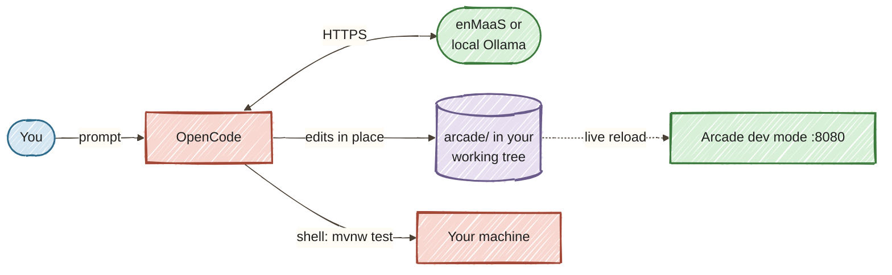

# 03 · Act 1: fix a game with OpenCode

## Goal

Fix the Trivia Quiz with OpenCode, reload the page to see the fix, and look at *how* it got there: in place, with a
shell, on your machine. This is the familiar way to use a coding assistant, and the baseline for Act 2.

## How OpenCode works here



[`opencode.jsonc`](../../opencode.jsonc) configures two providers: **Red Hat enMaaS** (default, DeepSeek V4.1 Flash,
key from `ENMAAS_KEY`) and **Ollama (local)** (`qwen3:4b-instruct`). The repository's
[`AGENTS.md`](../../AGENTS.md) tells OpenCode to fix arcade bugs in `arcade/` and run only the related test.

## Steps

### 1. Start OpenCode in the repository root

Keep the dev-mode arcade from tutorial 02 running, and in a second terminal:

```bash
opencode
```

To use the local model instead, choose **Ollama (local)** with `/models`, or start with:

```bash
opencode -m ollama/qwen3:4b-instruct
```

### 2. Paste the Quiz banner prompt

```text
Add input validation to QuizResource so only answers A, B, C, or D are accepted and invalid answers return 400. Implement the fix and its test now without pausing for a plan.
```

### 3. Reload the game page

Open <http://localhost:8080/quiz?answer=CHEAT> again.

## What you should see

- OpenCode edits `arcade/src/main/java/io/agentcon/games/quiz/QuizResource.java` and its test, then runs
  `./mvnw -pl arcade test -Dtest=QuizResourceTest` in its shell. On enMaaS this took **34 seconds** end to end.
- The page now returns **HTTP 400** with `Invalid answer: expected A, B, C, or D`. A valid answer (`?answer=A`) still
  works.
- `git status` shows both files modified in your working tree.

### Optional: fix the other two games too

The other banner prompts also work with enMaaS. RPS took 32 seconds and returned
`Invalid move 'banana'. Valid moves are: ROCK, PAPER, SCISSORS.` with HTTP 400.

```text
Add input validation to RpsResource so invalid moves return a 400 Bad Request with a friendly message. Implement the fix and its test now without pausing for a plan.
```

```text
Make guesses in ScrambleResource case-insensitive. Implement the fix and its test now without pausing for a plan.
```

> **Warning:** with the local 4B model, the short Scramble prompt failed: the model searched the wrong path and gave
> up. Give small models the file paths. This version worked in 28 seconds:
>
> `In arcade/src/main/java/io/agentcon/games/scramble/ScrambleResource.java, make the guess check case-insensitive. Then update arcade/src/test/java/io/agentcon/games/ScrambleResourceTest.java so mixed-case guesses are expected to be correct, and run ./mvnw -pl arcade test -Dtest=ScrambleResourceTest. Do it now without pausing for a plan.`

If you fix RPS or Scramble here, put them back before Act 2, so the agent has something to fix. This keeps your Quiz
fix:

```bash
git checkout arcade/src/main/java/io/agentcon/games/rps arcade/src/main/java/io/agentcon/games/scramble arcade/src/test/java/io/agentcon/games/RpsResourceTest.java arcade/src/test/java/io/agentcon/games/ScrambleResourceTest.java
```

## Point out to the audience

It worked, and it was fast. Now ask what it *could* have done:

- It had a shell. The same session could run `curl … | sh`, read `arcade/config/demo-secrets.properties`, or send
  any file it read to the model.
- It changed your working tree directly; review happened after the fact, with `git diff`.
- The tests it ran executed workspace code on your machine, with your credentials and network.

None of that is a criticism of OpenCode: it is a general-purpose tool that trusts its user. Act 2 shows what changes
when the agent is built for a narrower, governed job.

## Key takeaways

- Same model, same prompt style, real fix in about half a minute.
- Verification is "reload the page", and the change is already in your tree.
- Controls are whatever the tool and your machine happen to provide.
