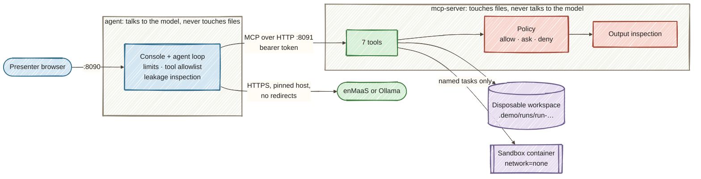

# 04 · Meet the agent console

## Goal

Start the Java agent and its MCP server, and learn to read the presenter console: what the agent may do, where the
model is, and where every decision appears.

## Two processes, two jobs



## Steps

### 1. Start the stack

```bash
scripts/start.sh enterprise
```

Use `scripts/start.sh local` for Ollama. The MCP server copies `arcade/` (as it is now, including your Quiz fix from
Act 1) into a fresh workspace under `.demo/runs/`. The agent can change only that copy.

### 2. Open the console

Open <http://127.0.0.1:8090>.

## What you should see

| Area | What it shows |
| --- | --- |
| Header | `profile: ENTERPRISE` (or `LOCAL`), the endpoint host, the model id, the workspace `run-…`, `sandbox: isolated container` |
| Demo flow | The six Act 2 steps. The current step's buttons are highlighted, and a step gets a checkmark when it has happened. Keys: **←** / **→** |
| Insight | What the audience is seeing and why it matters, with the key words highlighted. It changes with every action and result, contrasts with Act 1, and has a *Say* line for you. **i** hides the card, **p** hides the *Say* line |
| Developer request | A prompt box and preset buttons for the tasks and the bad actions |
| Presenter checks | Acceptance tests you own, run in the sandbox, with a FAILED/PASSED history |
| Deterministic probes | Fixed requests through the real MCP and policy path, with no model involved |
| Privacy boundary | The pinned model host, "credential: configured (hidden)", limits, leakage mode |
| Tool trace | Every tool call with a green **ALLOW**, amber **ASK** or red **DENY** badge and the rule that decided it |
| Promote to your arcade | The approved files and whether each would be copied into `arcade/`. The button works only after acceptance passed on these exact changes |
| Proposed changes | Diffs waiting for your approval, each with a patch hash, workspace and expiry |

The seven tools are `list_files`, `search_text`, `read_file`, `show_diff`, `propose_patch`, `apply_patch` and
`run_verification`. There is no shell tool.

## Key takeaways

- The process that talks to the model cannot touch files; the process that touches files never talks to the model.
- The agent works on a disposable copy, so nothing it does reaches your working tree without you.
- Every decision is visible and audited, and the console never shows hidden model reasoning.
