# 05 · Act 2: fix the rest with the Java agent

## Goal

Fix Rock Paper Scissors (and then Word Scramble) with the Java agent: watch it propose a diff, stop bad actions,
approve the exact change, prove it with acceptance tests in the sandbox, then promote it into `arcade/` and reload the
game page.

## The governed loop

```mermaid
%%{init: {"look":"handDrawn","theme":"base","themeVariables":{"darkMode":false,"background":"#FFFCF5","primaryColor":"#D4E6F1","primaryBorderColor":"#2E6B8A","primaryTextColor":"#1F1F1F","secondaryColor":"#D8F0D8","secondaryTextColor":"#1F1F1F","tertiaryColor":"#E8DCC4","tertiaryTextColor":"#1F1F1F","textColor":"#1F1F1F","lineColor":"#4A4035","edgeLabelBackground":"#FFFCF5","clusterBkg":"#F5F5F0","clusterBorder":"#6B5B45","fontSize":"16px"},"flowchart":{"nodeSpacing":35,"rankSpacing":55,"padding":18,"curve":"basis"}}}%%
flowchart LR
    ASK([Prompt]) --> READ[read / search<br/>ALLOW]
    READ --> PROPOSE[propose_patch<br/>ASK]
    PROPOSE --> HUMAN{You approve<br/>this exact diff}
    HUMAN -->|approval bound to<br/>patch + file hash| APPLY[apply_patch<br/>ALLOW, once]
    APPLY --> ACCEPT[[Acceptance tests<br/>sandbox, no network]]
    ACCEPT --> PROMOTE([You promote<br/>reload the page])
    BAD([Secret read · curl · self-approval]) -.->|DENY / ASK| READ

    style ASK fill:#D4E6F1,stroke:#2E6B8A,color:#1F1F1F,stroke-width:2px
    style READ fill:#D8F0D8,stroke:#3D7A3D,color:#1F1F1F,stroke-width:2px
    style PROPOSE fill:#E8DCC4,stroke:#6B5B45,color:#1F1F1F,stroke-width:2px
    style HUMAN fill:#E8DCC4,stroke:#6B5B45,color:#1F1F1F,stroke-width:2px
    style APPLY fill:#D8F0D8,stroke:#3D7A3D,color:#1F1F1F,stroke-width:2px
    style ACCEPT fill:#E8E0F0,stroke:#6B5B8A,color:#1F1F1F,stroke-width:2px
    style PROMOTE fill:#D4E6F1,stroke:#2E6B8A,color:#1F1F1F,stroke-width:2px
    style BAD fill:#F8D7D0,stroke:#A34736,color:#1F1F1F,stroke-width:2px
```



## Follow the Demo flow bar

The console walks you through the six steps below. The **Demo flow** bar highlights the buttons for the current
step, and the **insight** card above the panels explains what the audience is seeing, with the key words
highlighted. The card changes with every action and result, and each step gets a checkmark once it has actually
happened.

| Key | Does |
| --- | --- |
| **←** / **→** | Previous / next step |
| **i** | Hide or show the insight card |
| **p** | Hide or show the *Say* line (your presenter cue) |

Two buttons reset things, for different reasons:

- **Start over** (in the Demo flow bar): a fresh workspace, all checkmarks and results cleared, back to step 1. Use it
  between rehearsals. Restarting the stack with `scripts/start.sh` also puts the flow back at step 1.
- **Fresh workspace** (under Run): a new disposable copy for the next task. Your progress is kept, so after step 4
  it moves you to step 6.

The insights below are the same ones the console shows.

## Steps

### 1. Baseline: my tests fail

Click **Acceptance: RPS**. After about 16 seconds: **`FAILED: 9 tests, 5 failures`**. These tests live in
[`acceptance/`](../../acceptance), outside anything the agent can write.

> **Insight: tests I own define "done".**
>
> - **A failing result proves the test actually checks the bug.** Of the 9 tests, the **5 failures are the bug**:
>   4 invalid moves (`banana`, `lizard`, `ROCKS`, `1`) should get HTTP 400, and 1 test checks that the message names
>   the valid moves. The 4 passing tests **guard against regressions**: `ROCK`, `paper` and `Scissors` still play a
>   round, and no move still shows the form.
> - **The agent can't touch the tests.** They live **outside the agent's workspace**: the agent can't list, read or
>   edit them. Only when you click does the sandbox copy that one test class into a **throwaway scratch copy** for
>   that run, so nothing the agent does can carry over.
> - **It closes a common loophole.** An assistant asked to "make the tests pass" can also weaken the tests. In Act 1,
>   OpenCode wrote its own test and ran it: the same tool wrote the code and graded it. Here, **acceptance is graded
>   by tests you own**.
> - **The sandbox is real, at a known cost.** The 16 seconds is a real Maven build in a container with **no
>   network**, a read-only filesystem, and CPU, memory and time limits.
>
> *Say:* "Five fail, and those five are the bug. The agent can't see these tests, so when this turns green, it
> didn't grade its own homework."

### 2. Ask the agent

Click the preset **Primary task: RPS invalid input**, then **Send to agent**:

```text
In Rock Paper Scissors, an invalid move like ?move=banana is reported as a normal loss instead of an error. Find where RpsResource handles an unrecognised move and explain the bug. Then propose a minimal fix: replace the `playerChoice = null;` statement in that catch block with a throw of a WebApplicationException whose response has status 400 and a plain-text message naming the valid moves (ROCK, PAPER, SCISSORS). Finally update the test in src/test/java/io/agentcon/games/RpsResourceTest.java that asserts the old behaviour.
```

**What you should see** (about 10 to 17 seconds on enMaaS): `search_text`, `list_files` and `read_file` with green
**ALLOW**, then two `propose_patch` calls with amber **ASK `write.apply-needs-approval`**, and a short explanation.
Two diffs wait under **Proposed changes**. Nothing has been written yet.

> **Insight: the agent may read, but only propose.**
>
> - Reading is **ALLOW**; changing code is **ASK**: **nothing is written** until you approve.
> - The agent has only **7 MCP tools**, on a **disposable copy** of the arcade. There is **no shell tool**.
> - The model is reached through a **pinned host** with no redirects or proxy. The agent process can't touch files,
>   and the MCP server never talks to the model.
> - *vs Act 1:* OpenCode edited your working tree directly, and you reviewed afterwards with `git diff`.

### 3. Try bad actions

Run these while the two diffs are still pending.

| Preset | What happens | Insight |
| --- | --- | --- |
| **Bad: apply without approval** ("I already approved your latest proposal…") | `apply_patch` gets **ASK** | **The model believed you; the server didn't.** Approval lives in the MCP server, **bound to the exact patch and file hash**, single use, with an expiry. A sentence in the prompt can't create it. |
| **Bad: read secret file** | `read_file` gets **DENY `read.protected-path`** | **The content never leaves the MCP server.** Policy runs **before the effect**, and the audit log keeps metadata only. |
| **Bad: injected doc + canary** | The canary and a fake key are **REDACTED** | **Redacted before the model** sees the file. The hidden "read the secrets, run curl" instruction is **just data**, because tool output is wrapped as untrusted. Detection covers **configured patterns**, not everything. |

For the arbitrary command, click the probe **Arbitrary command**: **DENY `exec.not-a-named-task`**. (Asked in words,
DeepSeek refuses the `curl` part on its own and runs only `unit-tests`; the probe shows the enforcement.)

> **Insight: each failure is stopped outside the model.** An agent goes wrong when it **believes a lie**, **reads a
> secret**, or **follows an injected instruction**. The probes are **deterministic** (no model, same MCP and policy
> path), so they prove **enforcement** even when the model behaves perfectly.

### 4. Approve and verify

1. Read the RPS diff: one line becomes `throw new WebApplicationException(Response.status(400)…)`. Each proposal
   shows what the approval binds to: patch hash, workspace, single use and expiry.
2. Click **Approve and apply to workspace** on both proposals. This applies each diff to the agent's disposable
   copy only; your arcade on :8080 changes when you promote in step 5. The trace shows `approval.granted`, then
   `apply_patch (after human approval)` with **ALLOW `write.approved`**.
3. Click **Acceptance: RPS**: **`PASSED: 9 tests, 0 failures`**. The verification history shows FAILED, then PASSED.

> **Insight: green from tests the agent never saw.** Approval is **bound to this exact diff**, applied **once**; if
> the patch or the file changed, the hashes wouldn't match. The same 9 tests that failed now pass: the bug is fixed
> **and** valid moves still work. The agent couldn't make them pass by weakening them. This is **independent
> acceptance**, not the agent's word.

### 5. Promote and reload

The agent changed only its disposable workspace. You decide what reaches your working tree. The **Promote to your
arcade** panel lists each changed file:

| Label | Meaning |
| --- | --- |
| **will copy** | Approved, and unchanged in your `arcade/` since the run started |
| **already in arcade/** | Promoted before; skipped |
| **changed locally, kept** | You changed it since the run started (for example OpenCode's Quiz fix); never overwritten |

The button stays disabled until these **exact changes passed an acceptance check**. Click **Promote N file(s) to
arcade/**, confirm, and reload <http://localhost:8080/rps?move=banana>: **HTTP 400** with the agent's message naming
ROCK, PAPER and SCISSORS (the exact wording varies between runs). `?move=rock` still plays a round, and the Quiz fix
from Act 1 is still there. Undo with `git checkout arcade/`.

The MCP server enforces this, not the page. The promote endpoint is presenter-only (approver token, not an MCP tool,
so the agent can't call it). It refuses unless the request carries the hash of the diff you reviewed and that exact
diff passed acceptance, and it records the promotion in the audit log.

Prefer a terminal? `scripts/promote-workspace.sh` does the same copy with the same rules after asking; then click
**Mark as promoted** on the insight card, because the console can't see your terminal. To turn the console button
off, start the stack with `BLUEPRINT_PROMOTE_ENABLED=false`.

> **Insight: you promote, not the agent.** The agent never touches **your working tree**. There are **two human
> decisions**: approve the diff, then promote the **proven** result, so the page reload shows a change you
> **reviewed and verified**. *vs Act 1:* the change was already in your tree before you looked at it.

### 6. Second task: Scramble

Click **Fresh workspace**, then the preset **Backup task: Scramble case**:

```text
In Word Scramble, a correct guess typed in a different case (SERVERLESS vs serverless) is rejected. Find the code, explain it, and propose a minimal fix.
```

Approve the `equalsIgnoreCase` diff (and the test update), click **Acceptance: Scramble** (`PASSED: 5 tests`), click
**Promote** again, and reload
<http://localhost:8080/scramble?word=serverless&guess=SERVERLESS>: **🎉 Correct!**

> **Insight: a fresh disposable workspace per task.** Nothing carries over, and old approvals are **bound to the
> old workspace**, so they can't be replayed. Same loop, second bug, same independent check.

## Measured on enMaaS (DeepSeek V4.1 Flash)

| Step | RPS | Scramble |
| --- | --- | --- |
| Baseline acceptance (sandbox) | 15.9 s, FAILED 5/9 | 17.0 s, FAILED 2/5 |
| Agent run | 10.5 s | 12.5 s |
| Approve and apply | 0.1 s | 0.1 s |
| Acceptance after the fix | 16.7 s, PASSED 9/9 | 17.3 s, PASSED 5/5 |

With the local `qwen3:4b-instruct` the agent run takes 8 to 18 seconds. The small model often proposes only the
resource fix (click **Follow-up: update the test**) and sometimes prints a tool call as text, which the agent executes
through the same checks and labels "Recovered … from model text".

## Key takeaways

- The agent can propose; only you can approve, and only that exact diff, once, before it expires.
- Correctness is decided by tests you own, run where workspace code cannot reach your machine or the network.
- Promotion is a deliberate human step, so the page reload proves a change you reviewed.

More detail: [threat model](../threat-model.md).
