# Your Code Never Leaves

A hands-on path through a **private, Claude Code-style coding agent in Java**. You fix the same buggy game arcade
twice: first with **OpenCode**, a general-purpose coding assistant, then with a **Java agent** built on Quarkus,
LangChain4j and a Java MCP server. Both use the same private model (Red Hat enMaaS, or a local model with Ollama).
The difference is everything around the model: what the assistant is allowed to touch, who approves a change, where
tests run, and what never reaches the model.

[](https://github.com/danieloh30/private-agent-blueprint/actions/workflows/ci.yml) [](https://github.com/danieloh30/private-agent-blueprint/actions/workflows/pages.yml)

> **Where it has been tested.** Every step below was run on an Apple M4 Max (64 GB, macOS, Podman 6.1, Java 25)
> against enMaaS (`rits/deepseek-ai/DeepSeek-V4.1-Flash-1017`) and a local `qwen3:4b-instruct`. The timings on
> these pages are from those runs. This is a demonstration, not a production system.

## The demo in one picture

```mermaid
%%{init: {"look":"handDrawn","theme":"base","themeVariables":{"darkMode":false,"background":"#FFFCF5","primaryColor":"#D4E6F1","primaryBorderColor":"#2E6B8A","primaryTextColor":"#1F1F1F","secondaryColor":"#D8F0D8","secondaryTextColor":"#1F1F1F","tertiaryColor":"#E8DCC4","tertiaryTextColor":"#1F1F1F","textColor":"#1F1F1F","lineColor":"#4A4035","edgeLabelBackground":"#FFFCF5","clusterBkg":"#F5F5F0","clusterBorder":"#6B5B45","fontSize":"16px"},"flowchart":{"nodeSpacing":35,"rankSpacing":55,"padding":18,"curve":"basis"}}}%%
flowchart LR
    PLAY([1 · Play the arcade<br/>see three bugs]) --> OC[2 · Act 1: OpenCode<br/>fixes a game in place]
    OC --> RELOAD1([Reload the page<br/>bug gone])
    RELOAD1 --> AGENT[3 · Act 2: Java agent<br/>proposes a diff]
    AGENT --> APPROVE{You approve<br/>that exact diff}
    APPROVE --> SANDBOX[[Acceptance tests<br/>in a sandbox]]
    SANDBOX --> PROMOTE([Promote the change<br/>reload the page])

    style PLAY fill:#D4E6F1,stroke:#2E6B8A,color:#1F1F1F,stroke-width:2px
    style OC fill:#F8D7D0,stroke:#A34736,color:#1F1F1F,stroke-width:2px
    style RELOAD1 fill:#D4E6F1,stroke:#2E6B8A,color:#1F1F1F,stroke-width:2px
    style AGENT fill:#D8F0D8,stroke:#3D7A3D,color:#1F1F1F,stroke-width:2px
    style APPROVE fill:#E8DCC4,stroke:#6B5B45,color:#1F1F1F,stroke-width:2px
    style SANDBOX fill:#E8E0F0,stroke:#6B5B8A,color:#1F1F1F,stroke-width:2px
    style PROMOTE fill:#D4E6F1,stroke:#2E6B8A,color:#1F1F1F,stroke-width:2px
```



## Three games, three seeded bugs

| Game | URL | Bug you can see | Who fixes it in this tutorial |
| --- | --- | --- | --- |
| 🧠 Trivia Quiz | <http://localhost:8080/quiz?answer=CHEAT> | Any answer is accepted, even `CHEAT` | **OpenCode** ([03](03-fix-with-opencode.md)) |
| ✊ Rock Paper Scissors | <http://localhost:8080/rps?move=banana> | An invalid move is reported as a normal loss | **Java agent**, primary task ([05](05-fix-with-the-agent.md)) |
| 🔤 Word Scramble | <http://localhost:8080/scramble?word=serverless&guess=SERVERLESS> | A correct guess in another case is rejected | **Java agent**, second task ([05](05-fix-with-the-agent.md)) |

Each game page has an amber banner that describes its bug and gives a ready-made prompt for a coding assistant.
OpenCode can fix all three (each was rehearsed); the split above keeps the two acts distinct and shows both styles on
a live audience in about 12 minutes.

## Two ways to fix the same bug

| | OpenCode (Act 1) | Java agent (Act 2) |
| --- | --- | --- |
| Model | enMaaS or local Ollama | The same enMaaS or local model |
| What it can touch | Your working tree, a shell, any file it can read | Seven MCP tools on a disposable copy of the arcade; protected files are denied |
| When code changes | Immediately, in place | Only after you approve that exact diff in the console |
| Where tests run | On your machine, in its shell | In a container with no network, read-only filesystem, CPU/memory/time limits |
| Secrets and canaries | Whatever it reads goes to the model | Redacted or blocked before the model, the trace or a log |
| Verification | Reload the game page | Presenter-owned acceptance tests, then promote and reload |

## Tutorials

| # | Tutorial | Needs |
| --- | --- | --- |
| 01 | [Set up](01-set-up.md) | Java 25, Podman, an enMaaS key or Ollama |
| 02 | [Play the arcade](02-play-the-arcade.md) | Tutorial 01 |
| 03 | [Act 1: fix a game with OpenCode](03-fix-with-opencode.md) | OpenCode |
| 04 | [Meet the agent console](04-meet-the-agent-console.md) | Tutorial 01 |
| 05 | [Act 2: fix the rest with the Java agent](05-fix-with-the-agent.md) | Tutorial 04 |
| 06 | [Compare, collect evidence and reset](06-compare-and-reset.md) | Tutorials 03 and 05 |

Each tutorial has a **goal**, **steps** you can copy with the button on each code block, **what you should see**, and
**key takeaways**. The timed stage script is the [presenter runbook](../runbook.md).

## Prerequisites

- JDK 25 (the Maven Wrapper is included) and Podman (or Docker). On macOS: `podman machine start`.
- [OpenCode](https://opencode.ai) for Act 1.
- A model, either:
  - **enMaaS** (default): an API key in `ENMAAS_KEY`, or
  - **Local**: [Ollama](https://ollama.com) with `qwen3:4b-instruct` (2.5 GB, works offline).

```bash
git clone https://github.com/danieloh30/private-agent-blueprint.git
cd private-agent-blueprint
java -version
```

Start with [01 · Set up](01-set-up.md).
